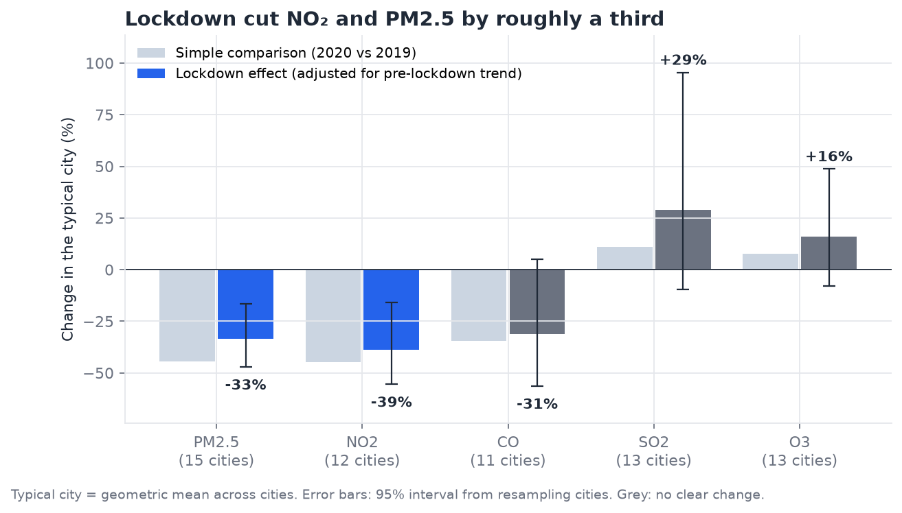
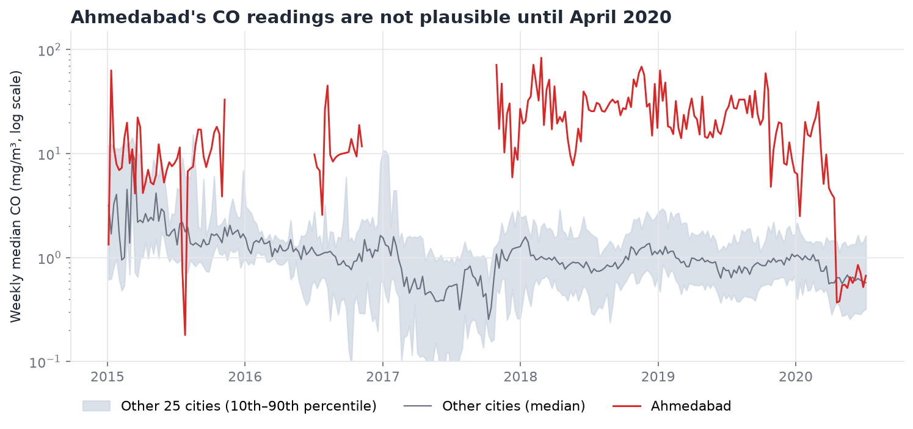
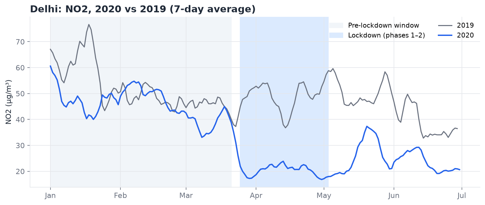
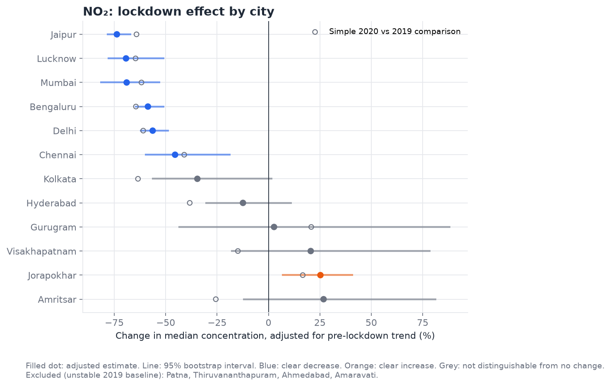
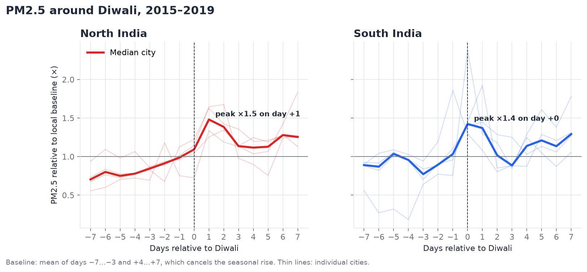
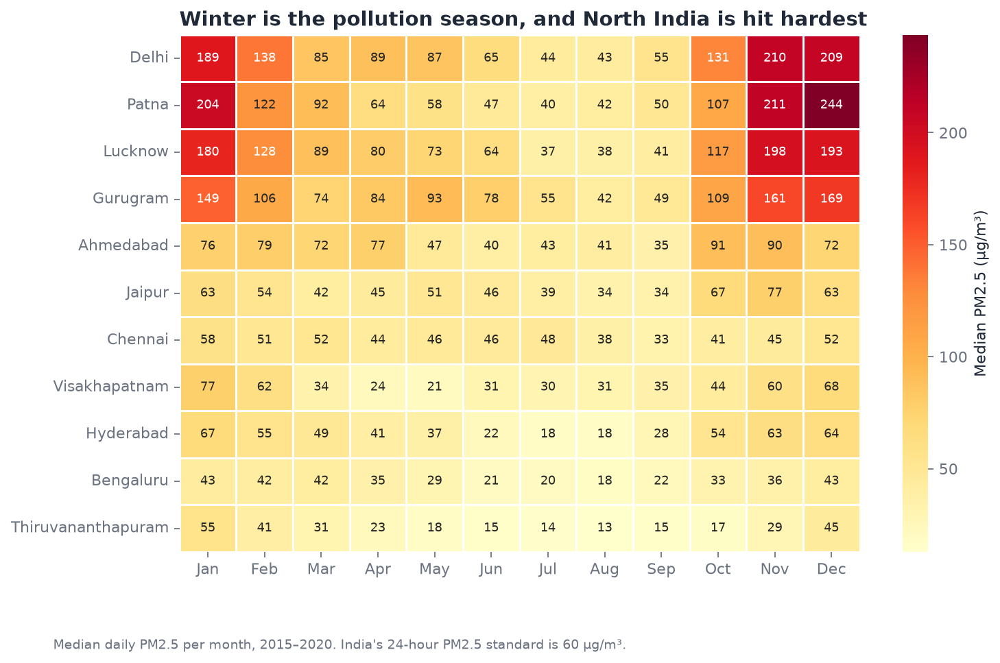
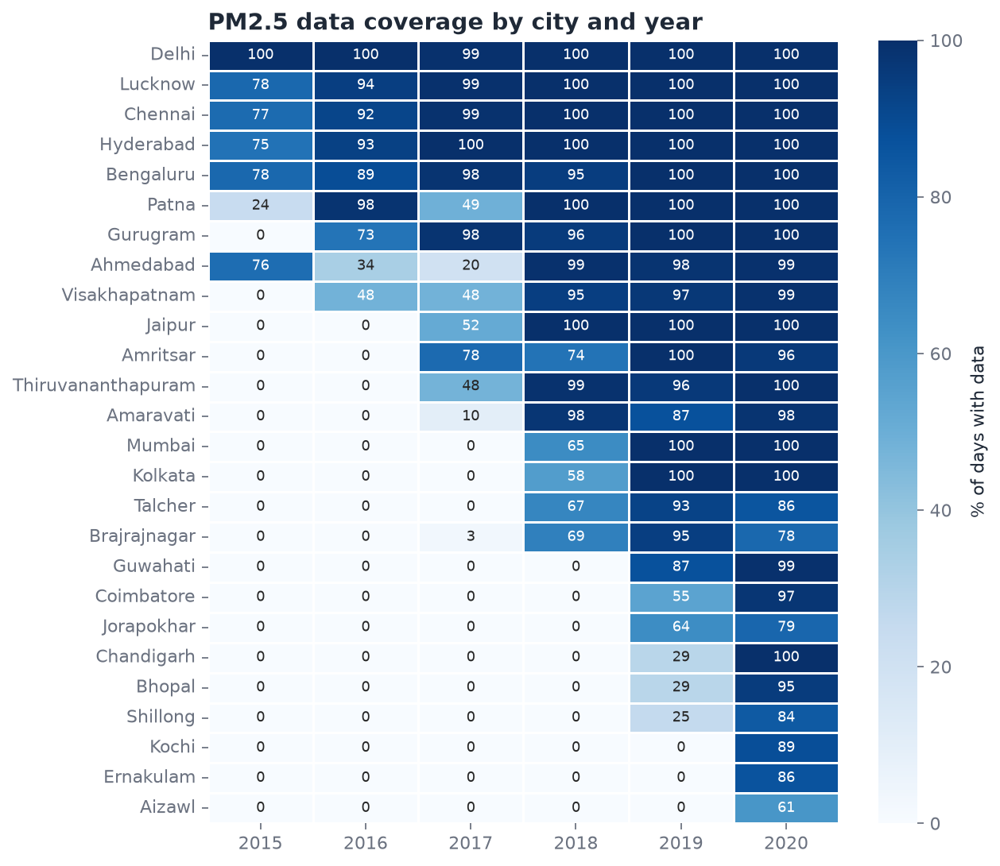

# India Air Quality Analysis


**How much did the 2020 COVID-19 lockdown really change air quality in Indian cities, and how much does Diwali add?**

An analysis of daily pollution data from 26 Indian cities (2015–2020) that goes beyond the usual "April 2020 vs April 2019" comparison. It corrects for differences that existed before the lockdown, reports uncertainty, and tests whether the conclusions survive different analysis choices.

<p align="center">
  
</p>

## Key findings

1. **The lockdown cut NO₂ by about 39% and PM2.5 by about 33%** in the typical city (95% intervals: −55% to −16% and −47% to −17%). Both results hold under every alternative analysis choice tested.
2. **The obvious comparison overstates the effect.** Early 2020 was already cleaner than early 2019, *before* the lockdown. Comparing the 2020 lockdown weeks directly with the same weeks of 2019 gives falls of about 45% for both pollutants.
3. **NO₂ fell most**, consistent with traffic being its main source. **SO₂ and ozone showed no clear fall**, consistent with coal power plants continuing to run and with ozone often rising when NO₂ drops.
4. **Diwali adds a short spike of 1.3–2.4× the surrounding level**, usually on the day *after* the festival, because each reading is a 24-hour average and the fireworks happen in the evening. In Chennai the peak comes the day *before*, consistent with Tamil Nadu celebrating Deepavali on Naraka Chaturdashi.
5. **In Delhi, the season matters far more than the festival.** Winter PM2.5 medians in Delhi, Patna, Lucknow and Gurugram reach 170–245 µg/m³, three to four times India's 24-hour standard. Some of Delhi's worst days come a week *after* Diwali, during stubble-burning season.
6. **The raw data contains sensor faults large enough to change conclusions.** Ranked by AQI, Ahmedabad looks more polluted than Delhi. That turns out to be a faulty CO sensor (below).

## Data quality: an anomaly worth investigating

Ahmedabad's AQI ranked worst of all 26 cities, ahead of Delhi, yet its PM2.5 is lower than in six other cities, Delhi among them. The cause: CO readings 10–40× above every other city for years, which then fall by 10× **within one week** in April 2020. Real emissions don't behave like that; a sensor or reporting fault does.

<p align="center">
  
</p>

All cleaning rules are explicit, documented in [`config.py`](src/air_quality/config.py) and covered by tests:

| Rule | Why |
|---|---|
| Remove Ahmedabad's CO and AQI | Implausible readings, abrupt 10× drop in April 2020 |
| Remove PM2.5 where it exceeds PM10 by >10% (199 days) | Physically impossible: PM2.5 is part of PM10 |
| Analyse individual pollutants, not AQI | A composite index can hide a single faulty sensor |
| Require ≥80% of calendar days in every compared window | Most cities have large gaps; comparisons must be like-for-like |
| Exclude cities whose pre-lockdown level changed >50% from 2019 | A change that large usually means the station changed, not the air |
| Use medians | Robust to the extreme values that can't be verified |

## Method

**Lockdown (difference-in-differences).** For each city, the median concentration is compared across four windows:

| | 2019 | 2020 |
|---|---|---|
| Pre-lockdown (1 Jan – 21 Mar) | A | B |
| Lockdown, phases 1–2 (25 Mar – 3 May) | C | D |

Lockdown effect = (D / C) ÷ (B / A) − 1. This removes any 2020-vs-2019 difference that already existed before the lockdown. City-level uncertainty comes from a **weekly block bootstrap**: days are resampled in whole weeks, because pollution on neighbouring days is correlated. Cities are combined with a geometric mean, and the interval comes from resampling cities.

**Diwali (event study).** Each day around Diwali is compared with a *local baseline*, the average of days −7…−3 and +4…+7. Because the baseline straddles the festival, the steady seasonal rise in October–November cancels out instead of being mistaken for a festival effect.

**Robustness.** The headline result is recomputed with means instead of medians, stricter and looser coverage thresholds, and stricter or no baseline filtering. NO₂ stays between −37% and −43% in every case; PM2.5 between −27% and −48%.

<p align="center">
  
</p>

<details>
<summary><b>More charts</b></summary>

<p align="center">
  
  
  
  
</p>
</details>

## Limitations

- **No weather adjustment.** Rain and wind clean the air, so differences in spring weather between 2019 and 2020 affect the estimate. Adding meteorological data is the most valuable next step.
- **One baseline year.** Most cities have no usable data before 2018, so 2019 is the only comparison year.
- **10–16 cities per pollutant**: enough for a clear direction, not for precise national figures.
- **Diwali estimates are lower bounds.** Lingering festival smoke in days +4…+7 raises the baseline.

## Project structure

```text
src/air_quality/       analysis package (cleaning rules, lockdown and event methods, charts)
notebooks/
  01_first_look.ipynb          guided first exploration of the dataset
  02_data_quality.ipynb        validation, coverage, sensor anomalies, cleaning decisions
  03_lockdown_effect.ipynb     lockdown estimate, per-city results, robustness checks
  04_diwali_and_seasons.ipynb  seasonal profile and Diwali event study
tests/                 unit tests on synthetic data with known answers
reports/figures/       all charts
reports/tables/        all results as CSV
scripts/               data download
```

## Run it yourself

```bash
git clone https://github.com/siddharth0444/india-air-quality-analysis.git
cd india-air-quality-analysis
python3 -m venv .venv && source .venv/bin/activate
pip install -r requirements-dev.txt && pip install -e .

python scripts/download_data.py        # ~70 MB from Kaggle; no account needed
pytest                                 # run the tests
jupyter nbconvert --to notebook --execute --inplace notebooks/0[2-4]*.ipynb   # rebuild results
```

## Data

[Air Quality Data in India (2015–2020)](https://www.kaggle.com/datasets/rohanrao/air-quality-data-in-india) by Vopani on Kaggle (CC0: Public Domain), compiled from India's Central Pollution Control Board (CPCB). The data is downloaded by the script and not stored in this repository.

## Author

**Siddharth Rajak** · [LinkedIn](https://www.linkedin.com/in/siddharthrajak) · [GitHub](https://github.com/siddharth0444)
